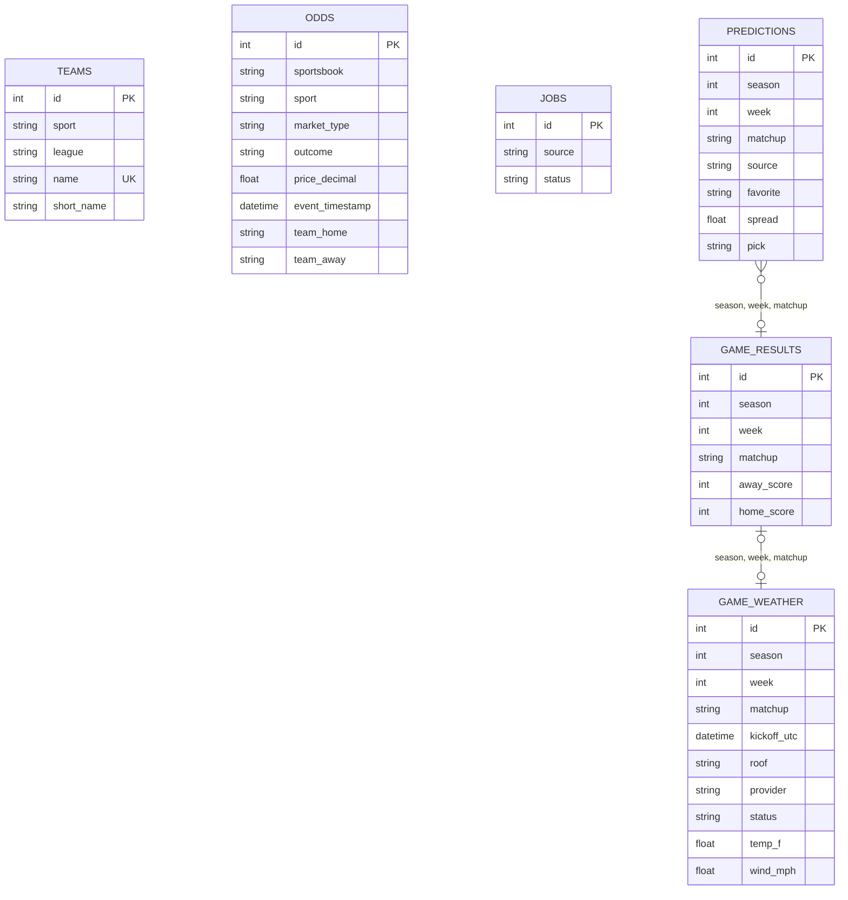

# 🏈 Sportsbook Assistant (MVP)

A FastAPI backend that ingests and normalizes sportsbook odds, records and grades
against-the-spread picks, and reports kickoff weather at each game's venue.
The project is an **infrastructure blueprint for data-driven sports intelligence**,
bridging ETL, analytics, and (later) LLM-based reasoning in one developer-friendly stack.

The repo has two independent halves:

1. **FastAPI backend** (`src/app/`) on Postgres, run in Podman.
2. **Weekly pick'em tooling** (`scripts/`): builds each week's pick'em tab from
   The Odds API and pushes it to the pool's Google Sheet on a Wednesday cron.
   See [`scripts/CLAUDE.md`](./scripts/CLAUDE.md) and
   [`docs/pickem-runbook.md`](./docs/pickem-runbook.md).

---

## 🛠 Technology Stack

| Layer | Technology | Purpose |
|-------|------------|---------|
| **API** | FastAPI | REST backend |
| **ORM** | SQLAlchemy 2 | Object-relational mapping |
| **Database** | Postgres 16 (psycopg v3) | Odds, picks, results, weather |
| **Infra** | Podman + podman-compose, devcontainer | Local development and tests |
| **Dependency Mgmt** | `uv`, `pyproject.toml`, `uv.lock` | Locked, audited dependencies |
| **Migrations** | Alembic | Schema evolution |
| **CI/CD** | GitHub Actions | Tests + pip-audit (`ci.yaml`), weekly pick'em cron (`pickem-weekly.yml`) |

---

## 🚀 Quick Start

Requires Podman with `podman-compose`. The dev compose file loads a local,
untracked `.env.example` (it is gitignored), so create one first with the
variables below. For the dev stack, set `POSTGRES_USER` and `POSTGRES_PASSWORD` to
`postgres` and `POSTGRES_DB` to `sportsbook`, matching the `db` service.

```bash
make dev               # builds the app and starts Postgres + FastAPI (hot reload)
```

- API: <http://localhost:8000>
- Interactive docs: <http://localhost:8000/docs>

Stop the stack with `make down`. `make prod` starts the production compose file.

### Environment variables

`src/app/config.py` builds the database URL from these (driver: psycopg v3).
A `DATABASE_URL` variable, if set, is **ignored**.

| Variable | Default | Purpose |
|----------|---------|---------|
| `POSTGRES_USER` | `sportsuser` | Database user |
| `POSTGRES_PASSWORD` | `sportspass` | Database password |
| `POSTGRES_HOST` | `sportsbook-db` | Database host (the dev compose container name) |
| `POSTGRES_DB` | `sportsbook` | Database name |
| `WEATHER_USER_AGENT` | project repo URL | Identifies us to the NWS API, which requires a User-Agent with working contact details; deployments should set e.g. `sportsbook-assistant (https://github.com/<owner>/sportsbook-assistant, you@example.com)` |
| `ODDS_API_KEY` | — | The Odds API key (pick'em tooling) |

> Env files are ignored by Git. In CI, set these as workflow variables or secrets.

---

## 🧭 API

| Method | Path | Purpose |
|--------|------|---------|
| `GET` | `/` | Health check |
| `POST` | `/teams/` | Add a team (409 if the name exists) |
| `GET` | `/teams/` | List teams |
| `POST` | `/ingest/upload` | Upload odds as CSV or JSON; creates a job and inserts normalized rows |
| `POST` | `/ingest/scrape` | Queue a background fetch for a sport (currently a mock of The Odds API) |
| `POST` | `/predictions/` | Upsert ATS picks per source (`edwin`, `claude-chat`, …) |
| `GET` | `/predictions/` | List picks, graded when a final score exists |
| `POST` | `/predictions/results` | Upsert final scores |
| `GET` | `/predictions/results` | List final scores |
| `GET` | `/predictions/standings` | W-L-P per source for a season (and optional week) |
| `POST` | `/weather/refresh` | Fetch and store the kickoff-hour forecast for a list of games |
| `GET` | `/weather/` | List stored forecasts (filter by `season`, `week`, `matchup`) |

Games are keyed by `(season, week, matchup)`, where `matchup` is `AWAY@HOME`
(case-insensitive; `WAS`, `JAC`, and `LA` normalize to `WSH`, `JAX`, and `LAR`).

### Weather at the venue

```bash
curl -X POST localhost:8000/weather/refresh -H 'content-type: application/json' -d '{
  "season": 2026, "week": 5,
  "games": [
    {"matchup": "MIA@BUF", "kickoff_utc": "2026-10-04T17:00:00Z"},
    {"matchup": "JAX@CLE", "kickoff_utc": "2026-10-04T13:30:00Z", "venue": "tottenham"}
  ]}'
```

- The venue is the home team's stadium, or a neutral site given by `venue`
  (`tottenham`, `wembley`, `munich`, `madrid`, `mexico-city`, …; see
  `src/app/services/stadiums.py`).
- **US venues** use the [National Weather Service API](https://www.weather.gov/documentation/services-web-api)
  (hourly, about 6 days ahead). **International venues** use
  [Open-Meteo](https://open-meteo.com/) (about 15 days ahead).
- **Domes** return `status: "indoor"` and are never fetched. Retractable roofs
  get a forecast, since the roof decision isn't known in advance.
- `status` is `ok`, `indoor`, `out_of_range` (kicked off more than 3 hours ago,
  or beyond the forecast horizon), or `error`. A game that kicked off within the
  last 3 hours gets the current hour's forecast.
- On `error`, `error` holds a stable code (`network`, `timeout`,
  `upstream_http_<status>`, `bad_payload`, `no_forecast_for_kickoff`); details go
  to the server log. The other games in the request still succeed.
- Each refresh overwrites the stored row. A request takes at most 20 games.
- Refreshes are on demand; nothing schedules them yet.

**Data sources and terms**

- NWS data is US-government open data. The API requires an identifying
  `User-Agent` (see `WEATHER_USER_AGENT`).
- Open-Meteo data is [CC BY 4.0](https://open-meteo.com/en/licence): show
  "Weather data by Open-Meteo.com" with a link wherever it appears. Rows from
  Open-Meteo carry this in their `attribution` field. The free API is
  [non-commercial only](https://open-meteo.com/en/terms) (about 10,000 calls a
  day); commercial use needs a paid plan.

---

## 🧪 Testing

```bash
make test                                                 # full suite in Podman against a throwaway Postgres
make test PYTEST_ARGS="tests/test_weather.py -q"          # one file
make test PYTEST_ARGS="tests/test_grading.py::test_grade_pick"  # one test
bash scripts/run-ci-local.sh                              # replay CI, including export check and pip-audit
```

Tests run on in-memory SQLite, but importing the app runs `create_all` against
Postgres, so they still need a reachable database (the `make test` stack supplies one).
No test touches the network: external APIs are replaced with fakes.
`tests/test_readme_features.py` checks this README against the Makefile and the
app's routes, so the docs fail CI when they drift.

After editing `pyproject.toml`, run `make lock` (re-lock and regenerate
`requirements/*.txt`) and `make audit`.

---

## 🗄 Database Schema



`teams`, `odds`, and `jobs` predate Alembic and exist only through `create_all`.
Migrations in `src/alembic/` add `predictions`, `game_results`, and `game_weather`.
On a database where the app has already booted, run `alembic stamp head` instead of `upgrade`.

---

## 🔁 Development Workflow

1. Branch from `main`.
2. Run `make test` (and `scripts/run-ci-local.sh` for dependency changes).
3. Commit cleanly (`.env` and `.DS_Store` are ignored).
4. Open a pull request into `main`.

## 📘 Documentation

| Document | Purpose |
|----------|---------|
| [`VISION.md`](./docs/VISION.md) | Why this project exists |
| [`ROADMAP.md`](./docs/ROADMAP.md) | Development milestones |
| [`ARCHITECTURE.md`](./docs/ARCHITECTURE.md) | System design and technical rationale |
| [`session-handoff.md`](./docs/session-handoff.md) | Current state and next steps |
| [`pickem-runbook.md`](./docs/pickem-runbook.md) | Operating the weekly pick'em cron |

> For information and entertainment only; no outcome is guaranteed. If gambling is
> a problem, call 1-800-GAMBLER.

## 💡 Philosophy

> The Sportsbook Assistant is not just a betting tool: it's an infrastructure blueprint for
> data-driven sports intelligence, connecting ETL, analytics, and LLM-based reasoning into
> one developer-friendly stack.
